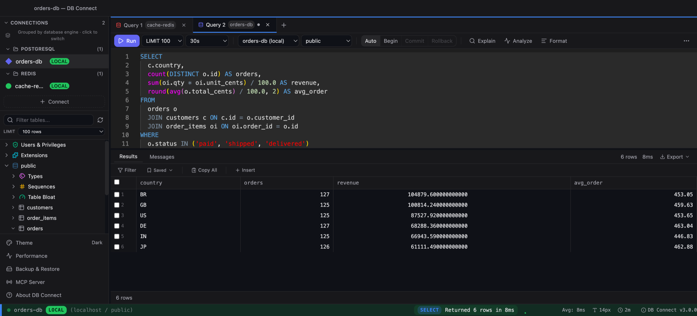
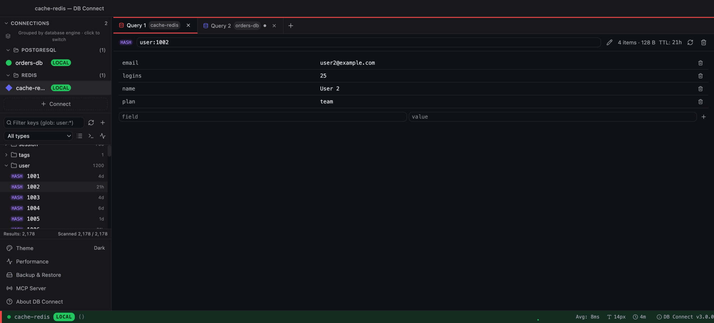
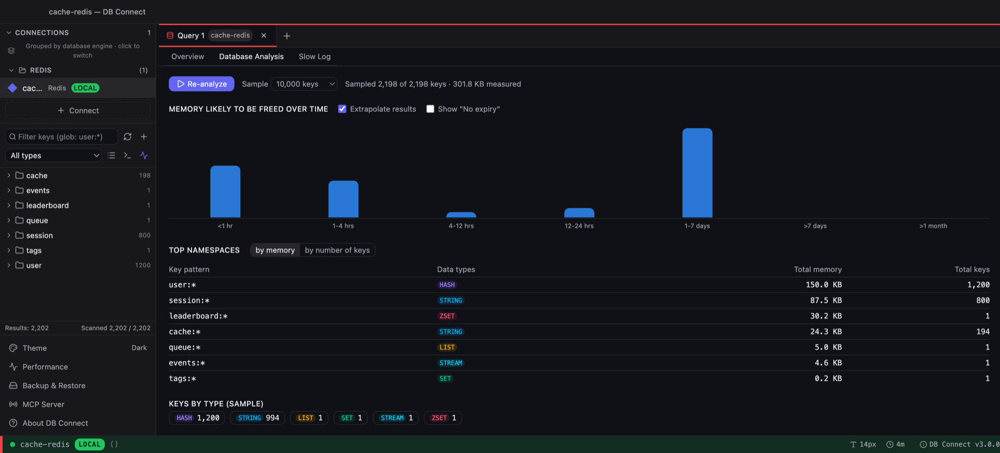
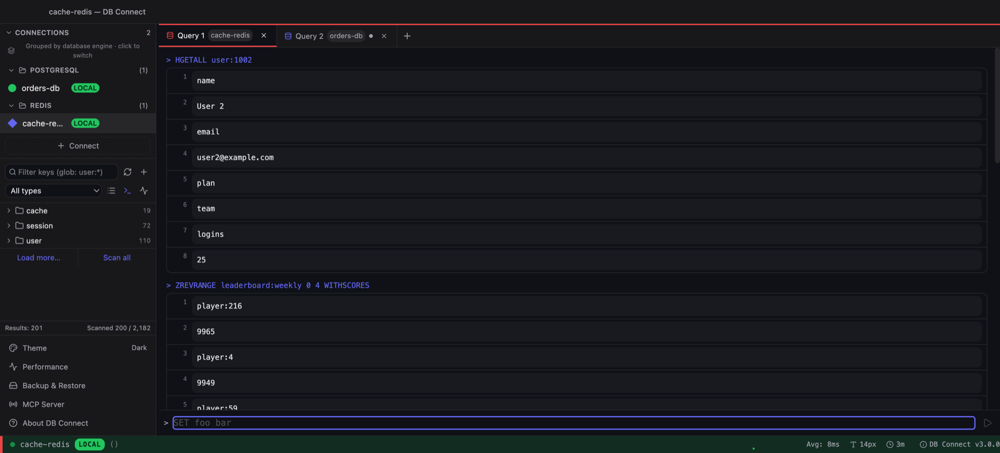
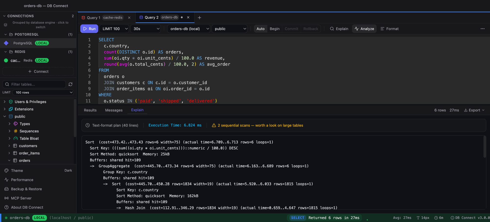

# DB Connect

**One database client for your entire backend stack.**

MySQL + PostgreSQL + Amazon Redshift + DynamoDB + Redis + MongoDB + Elasticsearch/OpenSearch + ClickHouse — one fast, free, native desktop IDE instead of eight separate tools and eight separate sets of saved credentials.

   



**Guides:** [MySQL](https://shubhesh07.github.io/db-connect/mysql-client.html) · [PostgreSQL](https://shubhesh07.github.io/db-connect/postgresql-client.html) · [Redshift](https://shubhesh07.github.io/db-connect/redshift-client.html) · [DynamoDB](https://shubhesh07.github.io/db-connect/dynamodb-gui.html) · [Redis](https://shubhesh07.github.io/db-connect/redis-gui.html) · [MongoDB](https://shubhesh07.github.io/db-connect/mongodb-client.html) · [Elasticsearch / OpenSearch](https://shubhesh07.github.io/db-connect/elasticsearch-client.html) · [ClickHouse](https://shubhesh07.github.io/db-connect/clickhouse-client.html) · [Case study: MySQL CPU 90% → 30%](https://shubhesh07.github.io/db-connect/mysql-cpu-case-study.html)
**Compared with:** [DataGrip](https://shubhesh07.github.io/db-connect/vs-datagrip.html) · [DBeaver](https://shubhesh07.github.io/db-connect/vs-dbeaver.html) · [TablePlus](https://shubhesh07.github.io/db-connect/vs-tableplus.html) · [MySQL Workbench](https://shubhesh07.github.io/db-connect/vs-mysql-workbench.html) · [Sequel Ace](https://shubhesh07.github.io/db-connect/vs-sequel-ace.html) · [pgAdmin](https://shubhesh07.github.io/db-connect/vs-pgadmin.html) · [RedisInsight](https://shubhesh07.github.io/db-connect/vs-redisinsight.html) · [NoSQL Workbench](https://shubhesh07.github.io/db-connect/vs-nosql-workbench.html) · [Dynobase](https://shubhesh07.github.io/db-connect/vs-dynobase.html) · [MongoDB Compass](https://shubhesh07.github.io/db-connect/vs-mongodb-compass.html) · [Studio 3T](https://shubhesh07.github.io/db-connect/vs-studio-3t.html)

## Download

| | |
|---|---|
| **macOS** (recommended: Homebrew) | `brew install --cask shubhesh07/db-connect/db-connect` |
| **macOS** (no Homebrew) | `curl -fsSL https://github.com/shubhesh07/db-connect/releases/latest/download/install.sh \| bash` |
| **Windows** | [Download DBConnect-Windows-Setup.exe](https://github.com/shubhesh07/db-connect/releases/latest/download/DBConnect-Windows-Setup.exe) |

Full manual-download links (DMG, portable ZIPs) are in [Manual downloads](#manual-downloads) below.

## Why DB Connect?

- **One tool, not three.** If your stack is MySQL or PostgreSQL for transactional data, Redshift for analytics, DynamoDB for high-throughput key-value access, Redis for caching, MongoDB for documents, Elasticsearch or OpenSearch for search and ClickHouse for analytics, you know the pain of a GUI client, credential store and query history per engine. DB Connect treats all eight engines as equal, first-class citizens.
- **Free forever.** No subscription, no trial limits, no feature paywall.
- **Fast.** Opens in under 2 seconds. ~35 MB installed. Built with Go + Wails — a native app, not Electron, so there's no bundled Chromium sitting in your dock for a database browser.
- **DynamoDB done properly.** A visual Scan/Query/GetItem builder *and* a PartiQL editor for writing real `SELECT * FROM "table" WHERE ...` statements — most GUI database tools ignore DynamoDB entirely or bolt on a bare-bones table browser.
- **Built to work with your AI coding tools.** A local MCP server lets Claude Code, Cursor, or any MCP-aware client query your already-open connections directly — schema, read-only queries, gated behind a per-install auth token, an explicit connection allow-list, and time-bounded write grants.
- **No cloud sync, no telemetry.** Credentials are AES-256-GCM encrypted with the key in your OS keychain. Nothing you connect to or query ever leaves your machine.

## MySQL · Redshift · DynamoDB · Elasticsearch

| | MySQL | Redshift | DynamoDB | Elasticsearch / OpenSearch |
|---|---|---|---|---|
| SQL query editor | ✅ | ✅ | — | ✅ (`_sql` / `_plugins/_sql`) + Kibana-style console |
| PartiQL query editor | — | — | ✅ | — |
| Visual Scan/Query/GetItem builder | — | — | ✅ | — |
| Schema/table browser | ✅ | ✅ | ✅ | ✅ (indices, aliases, mapping fields) |
| Context-aware autocomplete | ✅ | ✅ | ✅ (keywords, tables, per-table attributes) | ✅ (endpoints, query DSL, mapped fields) |
| EXPLAIN visualization | ✅ | ✅ | — | ✅ (Profile and Explain trees) |
| Inline row editing | ✅ | ✅ | ✅ (item editor) | ✅ (grid + document editor) |
| Table designer (CREATE/ALTER) | ✅ | — | — | — |
| Index manager | ✅ | — | — | ✅ (new/delete index, aliases, reindex) |
| Transactions | ✅ | — | — | — |
| SSH tunnel | ✅ | — | — | ✅ |
| GSI-aware querying | — | — | ✅ | — |
| Multiple AWS auth modes (access key, SSO profile, IAM role) | — | — | ✅ | — |
| Real backup/restore (`mysqldump`) | ✅ | ✅ | — | — |
| Native performance monitoring | ✅ | ✅ | ✅ (capacity/throttle, no CloudWatch) | ✅ (health, rates, tasks, shards, hot threads) |
| Export (CSV, JSON, Excel) | ✅ | ✅ | ✅ | ✅ (streams through cursor or scroll) |

## Elasticsearch / OpenSearch

New in v3.7.0, the seventh engine. [Full guide](https://shubhesh07.github.io/db-connect/elasticsearch-client.html).

- **Connect** to Elasticsearch or OpenSearch: self-managed, Elastic Cloud, AWS OpenSearch Service and AWS Elasticsearch domains. Username and password or an API key, TLS with a custom CA, SSH tunnel. The distribution and version are detected on connect; AWS domains get a port and TLS hint if misconfigured.
- **Explorer**: indices with aliases, doc counts and health, expanding to mapping fields (nested objects, multi-fields). Right-click for Query (SQL), Search (console), Mapping, Settings, Stats, Count, Refresh, Reindex, Add alias, New index, Delete index, New document and Bulk insert; cluster-level Health, Nodes, Shards and Aliases.
- **SQL and console in one editor**: `SELECT … FROM index` (Elastic `_sql`, OpenSearch `_plugins/_sql`, or the Open Distro endpoint on AWS Elasticsearch domains, chosen automatically) or Kibana-style requests such as `GET /index/_search` with a JSON body, several per run, with endpoint and query-DSL autocomplete that knows your mapped field names.
- **Results and document editing**: hits become rows with `_index`, `_id`, `_score` and the source fields; aggregations arrive as a second result set; `_cat` output becomes a table. Edit cells, delete rows and insert documents from the grid (one `_update` per document) or in the full document editor. Load more through the SQL cursor or `from`/`size`; export streams through the cursor or scroll API.
- **Profile and Explain**: per-shard query, collector and aggregation timings as a tree, or why each hit scored.
- **Performance pane**: cluster health, search and indexing rates and latencies per node and index, heap, CPU and rejections, plus Tasks (with cancel), Shards (with allocation explain), Hot threads, Pending tasks and circuit breakers.
- **Safety**: read-only profiles and production confirmation apply to every write, including `DELETE`, `PUT`, `_update_by_query`, `_delete_by_query`, task cancel and document edits.
- **MCP**: `list_tables`, `describe_table`, `run_query` (SQL or console), `explain_query`, `active_sessions` and `cluster_health` work on Elasticsearch connections; writes still need a grant.

## ClickHouse

New in v3.8.0, the eighth engine. [Full guide](https://shubhesh07.github.io/db-connect/clickhouse-client.html).

- **Connect** over the HTTP interface (8123, or 8443 with TLS) with username and password, TLS with a custom CA and an SSH tunnel; ClickHouse Cloud is recognised from the host. Read-only profiles are enforced by the server (`readonly=2`, `allow_ddl=0` on every request).
- **Explorer**: tables grouped by engine family, primary/sorting/partition key badges, default kinds and codecs, skip indexes, materialized views with their target table, dictionaries, and Users & roles with a grants viewer.
- **Editor**: per-tab server sessions (`USE`, `SET`, temporary tables persist), exact 64-bit integers and decimals, Cancel via `KILL QUERY`, 30 diagnostics snippets over the system tables, Explain with Plan (parts and granules per index), Estimate, Pipeline and Syntax.
- **Grid edits with a dry run**: opt in per connection; every edited row is matched on the server first and must match exactly one row (twins and vanished rows are refused), the dialog shows the exact mutation and the parts it rewrites, and values are bound as typed query parameters.
- **Performance pane**: health overview, running queries with Kill, slow shapes from `system.query_log` with where they were fired from, merges and mutations with Kill, replication, parts and disks, errors, dictionaries; cluster-wide via `clusterAllReplicas`.
- **Export and import**: CSV, JSON Lines and Parquet streamed with `FORMAT`; import CSV, TSV, JSON Lines or Parquet into a table.
- **MCP**: `list_databases`, `list_tables`, `describe_table`, `run_query` (read-only without a grant), `explain_query`, `active_sessions`, `slow_queries` and `cluster_health`.

## How it compares

| Feature | DB Connect | DBeaver (Community) | DataGrip | TablePlus | Beekeeper Studio (Community) |
|---|:---:|:---:|:---:|:---:|:---:|
| Price | Free | Free | Free (non-commercial) / ~$99 yr¹ (commercial) | $99+ one-time² | Free |
| MySQL | ✅ | ✅ | ✅ | ✅ | ✅ |
| Redshift | ✅ | ✅ | ✅ | ✅ | ✅ |
| DynamoDB | ✅ (PartiQL + visual builder) | — (paid tiers only) | — | — | — (paid tiers only)³ |
| Native app (not JVM/Electron) | ✅ | — | — | ✅ | — |
| Install size | ~18MB | ~400MB | ~800MB | ~80MB | ~500MB |
| Startup time | <2s | 5–15s | 10–30s | <3s | — (Electron) |
| SSH tunnel | ✅ | ✅ | ✅ | ✅ | ✅ |
| Query history (persists across restarts) | ✅ | — (session-only in Community) | ✅ | ✅ | ✅ |
| Real backup/restore | ✅ | — | — | — | ✅ |
| Native performance monitoring | ✅ | — | — | — | — |
| Local MCP server (AI tool integration) | ✅ | — | — | — | — |
| macOS | ✅ | ✅ | ✅ | ✅ | ✅ |
| Windows | ✅ | ✅ | ✅ | ✅ | ✅ |

¹ DataGrip has been free for non-commercial use (learning, hobby, open-source) since October 2025; commercial use still requires a paid license.
² TablePlus's free tier caps open tabs/windows/filters; the one-time license runs $99–$129 depending on device count.
³ Beekeeper Studio's Community edition includes Redshift but gates DynamoDB to its paid Indie/Professional/Business tiers.

*Comparison reflects each product's free/community tier where one exists, verified against each vendor's own docs as of this writing. Corrections welcome — open an issue if something's out of date.*

### vs. popular MySQL-only tools

DB Connect, DBeaver, DataGrip, TablePlus, and Beekeeper Studio above all support multiple database engines. MySQL Workbench and Sequel Ace are two of the most popular *MySQL-only* clients, so they get their own table instead of a row full of dashes above:

| Feature | DB Connect | MySQL Workbench | Sequel Ace |
|---|:---:|:---:|:---:|
| Price | Free | Free (Community) | Free (open source, MIT) |
| MySQL | ✅ | ✅ | ✅ |
| Redshift | ✅ | — | — |
| DynamoDB | ✅ | — | — |
| Native app | ✅ | ✅ | ✅ |
| Platforms | macOS, Windows | macOS, Windows, Linux | macOS only |
| SSH tunnel | ✅ | ✅ | ✅ |
| Query history | ✅ | ✅ (persists across restarts) | ✅ |
| EXPLAIN | ✅ Visual | ✅ Visual | ✅ (text output) |
| Backup/restore | ✅ | ✅ | ✅ (SQL dump-based) |

MySQL Workbench is Oracle's official free tool and a genuinely solid choice if MySQL is the *only* engine you touch — its Visual Explain is long-standing and well-regarded. Sequel Ace (the free, open-source successor to Sequel Pro) is excellent if you're macOS-only and MySQL-only. Neither reaches beyond MySQL/MariaDB, which is the gap DB Connect fills if Redshift or DynamoDB are also in your stack.

## 30-second quick start

```bash
brew install --cask shubhesh07/db-connect/db-connect
```

1. Launch DB Connect
2. **Add Connection** → choose MySQL, PostgreSQL, Redshift, DynamoDB, Redis, MongoDB, Elasticsearch/OpenSearch, or ClickHouse
3. Enter credentials → **Test Connection** → **Save**
4. Write a query (or, for DynamoDB, use the visual builder or the PartiQL editor) → `Cmd+Enter` to run

### Connect Claude (MCP) in three steps

1. In DB Connect: sidebar → **MCP Server** → enable the server and tick the connections Claude may see (the allow-list).
2. In the same dialog, press **copy** next to *Set up in Claude* — it copies a ready-made command with your URL and auth token filled in:
   ```bash
   claude mcp add --transport http db-connect http://127.0.0.1:47823/mcp --header "Authorization: Bearer <your-token>"
   ```
3. Paste it in your terminal. Done — Claude Code can now list databases/tables/collections/indices, describe schemas, and run read-only queries (SQL, or console requests on Elasticsearch/OpenSearch) against the allow-listed connections. (`/mcp` inside Claude Code shows the connection.)

For **Claude Desktop** (or any JSON-configured MCP client), the dialog also has a copy button for the matching `mcpServers` JSON block — merge it into `claude_desktop_config.json` (Settings → Developer → Edit Config) and restart Claude Desktop.

Writes stay blocked until you grant them per connection, time-bounded, from the desktop app — an agent can never grant itself write access.

### Keyboard shortcuts

| Shortcut | Action |
|---|---|
| `Cmd+Enter` | Execute query |
| `Cmd+D` | Select current statement |
| `Cmd+K` | Command palette |
| `Cmd+T` / `Cmd+W` | New tab / close tab |
| `Cmd+S` | Save query |
| `Cmd+Shift+F` | Format SQL |
| `Cmd+E` | EXPLAIN current query |

## Security

- Credentials encrypted at rest with **AES-256-GCM**; the encryption key lives in the OS keychain (macOS Keychain / Windows Credential Manager) — never in a plaintext file.
- **No cloud sync.** Connection profiles, query history, and saved queries all stay on your machine (`~/.querypilot/`).
- **No telemetry.**
- Production-safety confirmation before destructive statements (`DELETE`/`DROP`/`TRUNCATE`/`UPDATE`/`ALTER`) on connections you've tagged as production — tiered by severity, not a single dismissible dialog.
- The optional local MCP server (off by default) requires a per-install bearer token, validates Host/Origin on every request, only reaches an explicit connection allow-list, and gates writes behind time-bounded, desktop-UI-only grants — an AI agent reachable via MCP can never grant itself write access.

## Performance

- **Virtual scrolling** — result grids render only visible rows plus a small buffer, so scrolling through hundreds of thousands of rows doesn't choke the DOM.
- **Goroutine-per-query** — every query runs in its own goroutine; a long-running analytics query on Redshift doesn't freeze the UI while you run a quick lookup on another tab.
- **Native binary, no runtime** — no JVM, no Electron/Chromium, no Node runtime. A single Go binary around 32MB (the SQL editor is bundled, no CDN), universal on macOS (Intel + Apple Silicon).

## Screenshots

### MySQL Performance Overview — live rates, health findings, click a metric for the queries behind it


### Redis key browser — keys grouped by `:` prefix, type-aware editors


### Redis analysis — memory by TTL, top namespaces, keys by type


### Redis console — replies rendered by type


### EXPLAIN ANALYZE


## Roadmap

Reordered toward the broadest database-client market first:

1. [x] **PostgreSQL support** — shipped in v2.4.0
1. [x] **Redis support** — shipped in v3.0.0: auto-detected cluster, Visual key browser, Analyze pane, MCP tools. MySQL + PostgreSQL + Redshift + DynamoDB + Redis covers most backend stacks people actually run
2. [ ] **Linux build** — Wails already supports it; needs a packaging/CI pipeline
3. [x] **ER diagram visualization (auto-generated from foreign keys)** — shipped in v3.1.0: right-click a MySQL database or PostgreSQL schema, laid out by foreign-key depth, pan/zoom, click a table to open it
4. [x] **Query result diffing (compare EXPLAIN output before/after an index change)** — shipped in v3.1.0: baseline a plan, change an index, re-run, and compare access type, key and rows examined with a per-table verdict
5. [x] **MongoDB support** — shipped in v3.2.0: SQL (translated to find/aggregate) or mongosh syntax, collection explorer with sampled fields, production/read-only gating, MCP tools
6. [x] **Elasticsearch / OpenSearch support** — shipped in v3.7.0: SQL and Kibana-style console in one editor, index explorer with mapping fields, document editing, Profile/Explain, performance pane, MCP tools
7. [x] **ClickHouse support** — shipped in v3.8.0: HTTP interface with per-tab sessions, engine-aware explorer, Explain with index pruning, system-tables performance pane, Parquet/CSV/JSON Lines export and import, grid edits behind a server-side dry run, MCP tools
8. [ ] Import/export connection profiles

## FAQ

**Is this actually free, or free-with-a-catch?**
Free for personal and commercial use, no subscription, no feature paywall, no account required. Source code is not open source (see [License](#license)).

**Why not just use DBeaver — it's free too?**
DBeaver Community is a solid generalist tool, but it's Java/Eclipse-based (slower startup, heavier footprint) and its DynamoDB support sits behind the paid tiers (Lite and above) — it's not in the free Community edition. DB Connect is built specifically around MySQL + Redshift + DynamoDB as equal citizens, starts in under 2 seconds, and is ~35 MB installed.

**Does DynamoDB support mean real SQL-like querying, or just a table browser?**
Both. There's a visual Scan/Query/GetItem builder for form-based filtering, and a PartiQL editor for writing `SELECT * FROM "table" WHERE ...` directly via AWS's native PartiQL support — with autocomplete that learns each table's attributes as you query it.

**Does the AI/MCP integration send my data anywhere?**
No. The MCP server is off by default, binds to `127.0.0.1` only, requires a bearer token, and only ever reaches connections you've explicitly allow-listed. It never dials a new connection and never returns credentials.

**Is my data or credentials ever synced to a cloud account?**
No. There's no account, no cloud sync, and no telemetry. Everything lives in `~/.querypilot/` on your machine.

**What platforms are supported?**
macOS 11.0+ (Intel & Apple Silicon) and Windows 10+ (64-bit) today. Linux is next on the roadmap.

**I found a bug / want a feature.**
Open an issue on GitHub — see [Author](#author) below.

---

## Manual downloads

### macOS

| File | Description |
|------|-------------|
| [DBConnect-macOS.dmg](https://github.com/shubhesh07/db-connect/releases/latest/download/DBConnect-macOS.dmg) | macOS installer (DMG) |
| [DBConnect-mac.zip](https://github.com/shubhesh07/db-connect/releases/latest/download/DBConnect-mac.zip) | macOS portable (ZIP) |

> If you downloaded the DMG manually and see **"DBConnect is damaged and can't be opened"**, run this once in Terminal:
>
> ```bash
> xattr -cr /Applications/DBConnect.app
> ```
>
> Or open the DMG and double-click the bundled `install-mac.sh` — it does the same thing for you.

### Windows

| File | Description |
|------|-------------|
| [DBConnect-Windows-Setup.exe](https://github.com/shubhesh07/db-connect/releases/latest/download/DBConnect-Windows-Setup.exe) | Windows installer (NSIS) |
| [DBConnect-Windows.zip](https://github.com/shubhesh07/db-connect/releases/latest/download/DBConnect-Windows.zip) | Windows portable (ZIP) |

## Data storage

All data stored locally at `~/.querypilot/`:

| File | Purpose |
|------|---------|
| `connections.enc` | Encrypted connection profiles |
| `history.db` | Query execution history |
| `saved_queries.db` | Named saved queries |

## Requirements

- **macOS:** 11.0 (Big Sur) or later
- **Windows:** Windows 10 or later (64-bit)

## Writing

- [DB Connect: a database IDE that lets your AI assistant actually query your database](https://dev.to/shubhesh07/-db-connect-a-database-ide-that-lets-your-ai-assistant-actually-query-your-database-4ea5) — the v2.2.0 launch post, on the MCP integration and why it's built with Go + Wails instead of Electron.

## Author

**Shubhesh Shukla**
- [LinkedIn](https://linkedin.com/in/shubheshshukla7)
- [GitHub](https://github.com/shubhesh07)

## License

Free for personal and commercial use. Source code is not open source.

## Keywords

`mysql client` `mysql gui` `mysql ide` `database tool` `sql editor` `dynamodb gui` `dynamodb client` `ddb client` `aws dynamodb tool` `redshift client` `redshift gui` `redshift query tool` `free database client` `database ide` `sql client mac` `sql client windows` `datagrip alternative` `dbeaver alternative` `tableplus alternative` `database management tool` `query editor` `schema browser` `elasticsearch client` `elasticsearch gui` `opensearch client` `opensearch gui` `kibana dev tools alternative` `clickhouse client` `clickhouse gui` `clickhouse ide`
